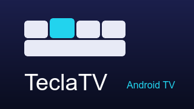

# TeclaTV

Teclado (IME) rápido y ligero para **Android TV**, hecho para el control remoto (D-pad). Sin dependencias, un solo View dibujado a mano, español + inglés.

## Instalar
1. Instala `TeclaTV-v1.0.0.apk` (Releases) en tu TV.
2. Abre **TeclaTV** → *1 · Activar* → *2 · Elegir como teclado*.

## Funciones
- Navegación D-pad con wrap-around y memoria de columna (sin saltos raros).
- Fila de números siempre visible; páginas de símbolos y acentos (á é í ó ú ü ñ ç ¿ ¡ € …).
- Sugerencias de palabras (ES/EN) que **aprenden** lo que escribes (local, sin red, sin permisos).
- Mayúscula automática, doble espacio → ". ", tecla de acción contextual (Buscar / Ir / Enviar…).
- Modos para email (@) y URL (/ y .com); contraseñas sin aprendizaje ni sugerencias.
- No tapa el campo de texto: el teclado reserva su espacio y la app se reajusta.
- Mando: **OK** escribe · mantener OK en a/e/i/o/u/n = acento · mantener OK en ⌫ = borra palabras · **Rojo** borrar · **Verde** espacio · **Amarillo** mayúsculas · **Azul** 123 · **⏪/⏩** mover cursor · **Atrás** cierra.

## Compilar
`gradlew assembleRelease` (JDK 17, Android SDK 36). Sin keystore propio se firma con la de debug.

Activación alternativa por ADB: `adb shell ime enable app.teclatv/.TeclaService && adb shell ime set app.teclatv/.TeclaService`
